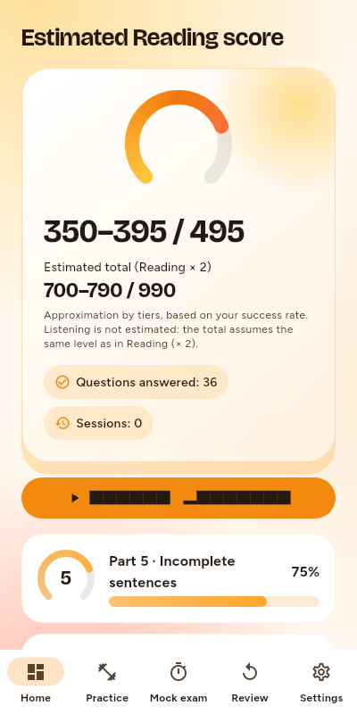
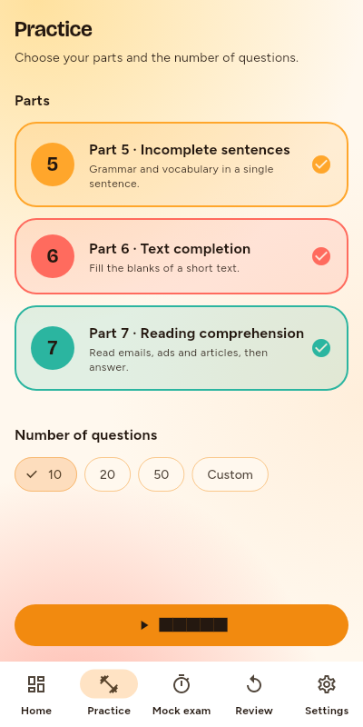
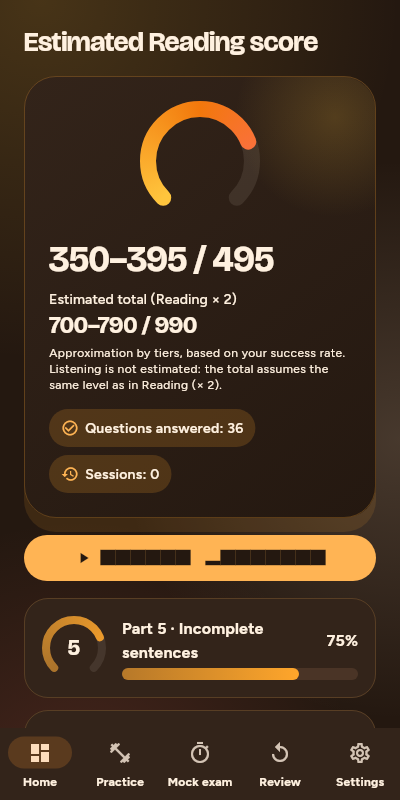

<div align="center">


# Toecly

**Prépare la partie Reading du TOEIC, où tu veux, sans connexion.**


[](https://github.com/drak3r-01/Toecly/actions/workflows/ci.yml)

</div>

---

## ✨ En bref

Toecly est une application d'entraînement au **TOEIC Reading (Parties 5, 6 et 7)**, pensée pour Android et Windows.
Elle fonctionne **entièrement hors ligne** : aucun compte, aucun appel réseau, aucune donnée qui quitte ton appareil.

<div align="center">



</div>

## 🎯 Fonctionnalités

| | |
|---|---|
| 🏋️ **Entraînement** | Parties 5, 6 et 7 au choix, nombre de questions libre, **correction immédiate** après chaque réponse. |
| ⏱️ **Examen blanc** | Format officiel : **100 questions en 75 minutes**, correction **à la fin**. |
| 🔁 **Révision** | Les questions ratées sont conservées (jusqu'à 500) pour les retravailler. |
| 🎯 **Objectif quotidien** | Nombre de questions par jour au choix, anneau de progression et **série de jours** sur l'accueil. |
| ⏸️ **Reprise de session** | Une session interrompue (retour Android, application fermée) se reprend là où tu t'es arrêté. |
| 🧭 **Points faibles** | Les catégories où ton taux de réussite est le plus bas, avec un entraînement ciblé en un clic. |
| 🃏 **Cartes de mots** | Vocabulaire professionnel du TOEIC en flashcards (50 mots pour l'instant). |
| 📊 **Score estimé** | Approximation par paliers à partir de ton taux de réussite : score Reading /495, aussi présenté ×2 sur /990. |
| 🔀 **Réponses mélangées** | L'ordre des choix change à chaque tirage : impossible de retenir « la réponse B ». |
| 🌍 **Interface FR / EN** | Langue du système par défaut, réglable à la main. Explications des questions en anglais. |
| 🎨 **Thèmes clair et sombre** | Palette chaude, dégradés pastel, barre de navigation flottante, animations, taille du texte réglable. |
| 📴 **100 % hors ligne** | Questions embarquées dans l'application, progression stockée localement. |

## 📚 Banque de questions

Niveau **C1 minimum**, comme le vrai TOEIC, avec une explication pour chaque question.

| Partie | Contenu | Questions |
|---|---|---|
| **5** | Phrases à compléter | 566 |
| **6** | Textes à compléter | 500 |
| **7** | Compréhension (documents simples et multiples) | 500 |

Les questions sont des fichiers JSON validés automatiquement en CI.
Les règles de rédaction sont dans le README de chaque dossier `assets/questions/partN/`.

## 🧰 Technologies

- **Flutter** (Android et Windows), **Riverpod** pour l'état, **go_router** pour la navigation
- Stockage local via **shared_preferences**, derrière une classe `LocalStore` (remplaçable par SQLite sans toucher au reste)
- Polices **Bricolage Grotesque** et **Figtree** (licence OFL, embarquées)
- **GitHub Actions** : validation des questions, analyse, tests, puis builds et release

## 🏗️ Architecture

```
lib/
  main.dart                  Point d'entrée (ProviderScope Riverpod)
  app/                       Application : providers, thème, réglages (thème, langue), routes
  core/                      Parties TOEIC, score estimé par paliers, widgets réutilisables
  data/
    exercises/               Modèles, parseur JSON, chargement des lots, tirage, format de l'examen blanc
    storage/                 LocalStore (seule porte vers shared_preferences) + dépôts : erreurs, stats, historique
  features/                  Un dossier par écran : dashboard, practice, mock_exam, review, settings, exercise
  l10n/                      Textes de l'interface : app_en.arb et app_fr.arb
assets/questions/part5|6|7/  Lots de questions (JSON) + un README par partie décrivant le format attendu
tool/validate_questions.dart Validation de tous les lots (aussi lancée en CI)
```

Choix techniques : **Riverpod** pour l'état, **go_router** pour la navigation, stockage JSON versionné derrière `LocalStore`
(passer plus tard à SQLite ne change que cette classe). Le code et les noms de fichiers sont en anglais ; l'interface est en
français et en anglais (langue du système par défaut, choix manuel dans les réglages) ; les explications des questions sont en anglais.

## 🚀 Lancer en développement

```bash
flutter pub get
flutter run -d windows          # fenêtre Windows
flutter run -d chrome           # aperçu navigateur
flutter run                     # appareil / émulateur Android connecté
```


## 📦 Compiler l'APK avec Docker (sans Android Studio)

```bash
docker compose run --rm build-apk
```

Résultat : `build/app/outputs/flutter-apk/app-release.apk`

## 🪟 Compiler le `.exe` en local sur Windows

Prérequis : Flutter + Visual Studio avec la charge « Développement Desktop en C++ ».

```bash
flutter build windows --release
```

Résultat : `build\windows\x64\runner\Release\toecly.exe`. Le `.exe` a besoin des DLL et du dossier `data\`
placés à côté de lui : distribuer **tout le dossier** `Release`.

## 🏷️ Release automatique (GitHub Actions)

Pousser un tag de version déclenche `.github/workflows/build.yml` : validation des lots, analyse et tests, puis build APK signé (Ubuntu) et Windows (zip) en parallèle,
puis création d'une release GitHub avec les deux fichiers.

```bash
git tag v0.1.0   # le tag doit commencer par « v »
git push origin v0.1.0
```

## ✍️ Ajouter des questions

Un lot est un fichier `.json` contenant une **liste d'exercices** d'une seule partie.

1. Lire le README du dossier de la partie (`assets/questions/part5/README.md`, `part6`, `part7`) et le format commun : [docs/QUESTION_FORMAT.md](docs/QUESTION_FORMAT.md).
2. Créer le fichier dans le bon dossier. Garder des `id` uniques et définitifs.
3. Vérifier : `dart run tool/validate_questions.dart` (signale champs manquants, `answerIndex` hors limites, ids en double...).
4. Recompiler : le fichier est embarqué et ses exercices rejoignent le tirage. Rien d'autre à modifier.

Tirage : partie 5 question par question, parties 6 et 7 par exercice entier. Examen blanc : 30 questions de partie 5, 4 exercices de
partie 6, 10 exercices simples et 5 multiples de partie 7 (100 questions, 75 min, correction à la fin).

Pour une nouvelle partie (ex. listening), créer le dossier `assets/questions/partN/` et l'ajouter à `assets:` dans `pubspec.yaml`
(Flutter ne lit pas les sous-dossiers récursivement).

### Cartes de mots

Même principe dans `assets/words/` : un fichier `.json` par lot, format décrit dans [assets/words/README.md](assets/words/README.md), vérifié par `dart run tool/validate_words.dart`.

## 🔐 Signer l'APK (une seule fois)

Android refuse d'installer une mise à jour signée avec une autre clé que l'ancienne version : il faut donc **toujours la même clé**.
Sans clé configurée, le build retombe sur la clé « debug » (utile en local, mais les mises à jour ne s'installeront pas par-dessus).

1. Générer la clé (à garder précieusement, **si elle est perdue, plus aucune mise à jour possible**) :
   ```bash
   keytool -genkeypair -v -keystore toecly-release.jks -alias toecly -keyalg RSA -keysize 2048 -validity 10000
   ```
2. Encoder le fichier : `base64 -w0 toecly-release.jks` (Linux) ou `[Convert]::ToBase64String([IO.File]::ReadAllBytes("toecly-release.jks"))` (PowerShell).
3. Dans GitHub : *Settings → Secrets and variables → Actions → New repository secret*, créer :
   `ANDROID_KEYSTORE_BASE64` (le texte de l'étape 2), `ANDROID_KEYSTORE_PASSWORD`, `ANDROID_KEY_ALIAS` (`toecly`), `ANDROID_KEY_PASSWORD`.
4. Le workflow de release lit ces secrets et signe l'APK. Ne jamais commiter le `.jks` ni `android/key.properties` (déjà dans `.gitignore`).

Pour signer en local, créer `android/key.properties` (`storeFile`, `storePassword`, `keyAlias`, `keyPassword`) ; `storeFile` est relatif à `android/`.

## ✅ Tests

```bash
dart run tool/validate_questions.dart
flutter analyze
flutter test
```

Les mêmes vérifications tournent en CI (`.github/workflows/ci.yml`) sur chaque pull request. Tests unitaires (parseur, tirage,
examen blanc, stockage, score) et de widgets (navigation, langue, thème, rendu des documents).

## 📄 Licence et crédits

- Logo et identité visuelle : Gabriel.
- Polices Bricolage Grotesque et Figtree sous licence [SIL OFL](assets/fonts/) (textes de licence fournis dans `assets/fonts/`).
- « TOEIC » est une marque déposée d'ETS, qui n'est pas affiliée à ce projet. Les questions de Toecly sont originales.
